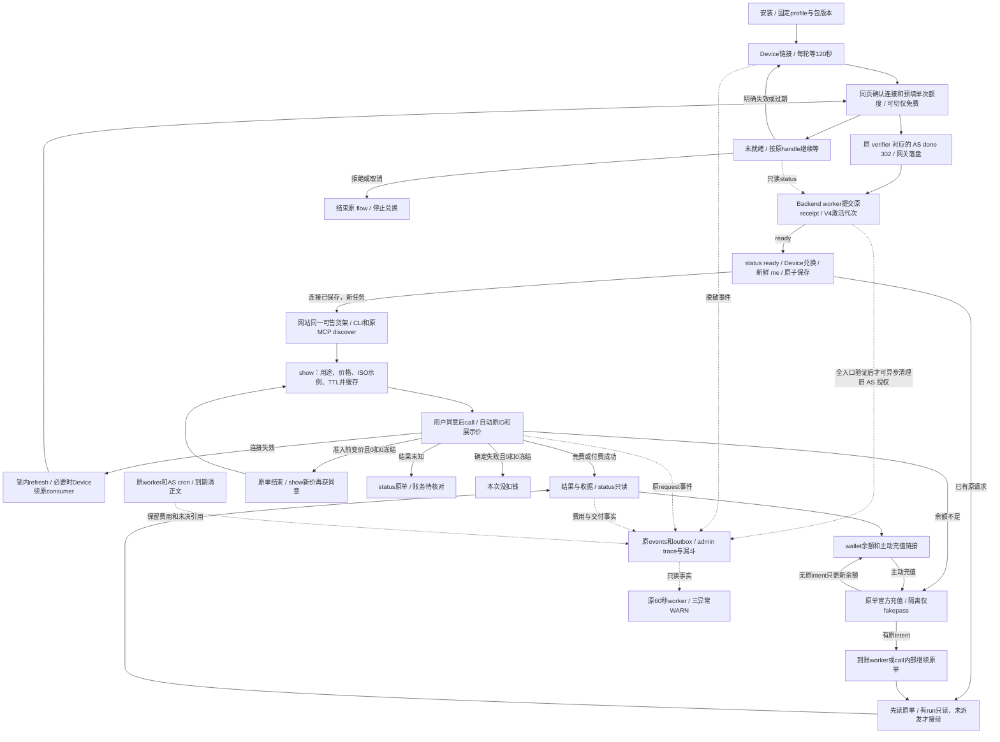

# ItPay CLI

Services与API两个入口；安装与正式Skill见现有setup及发布导航。

目标未实施：授权先做、货架后做，新增身份续接/同页同意合同待图复审；现有固定安装包保持现状。

[开发合同](docs/DEVELOPMENT.md#api-journey-contract) · [架构](docs/ARCHITECTURE.md) · [测试与证据](docs/TESTING.md#api-journey-evidence) · [维护入口](AGENTS.md) · [部署与发布](docs/RELEASE.md) · [合同](docs/CONTRACTS.md) · [待办](docs/BACKLOG.md)
