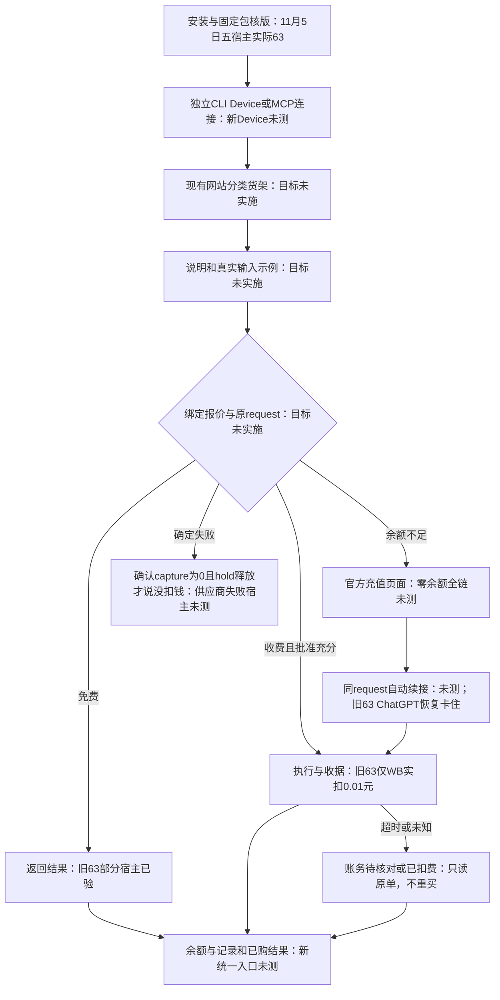
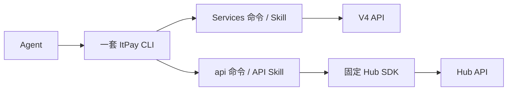
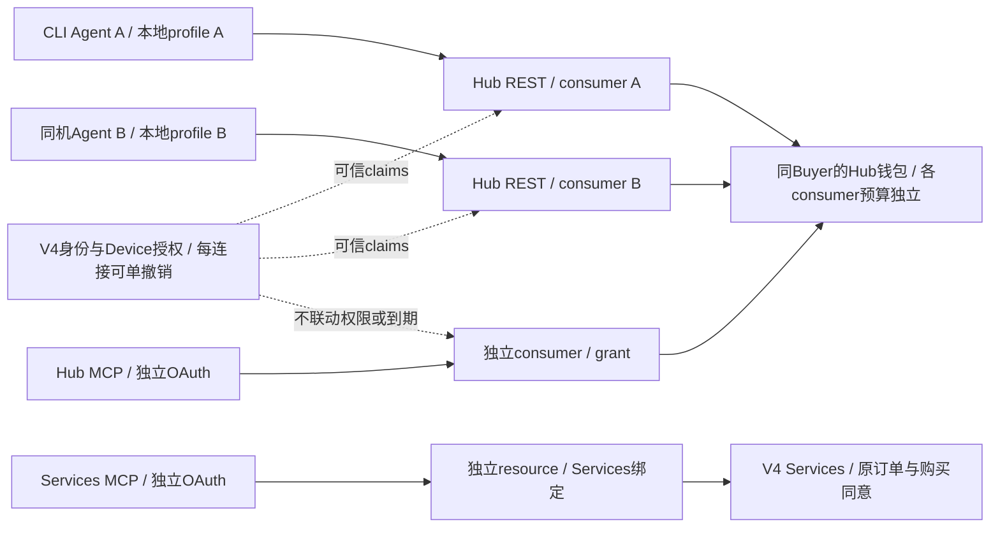
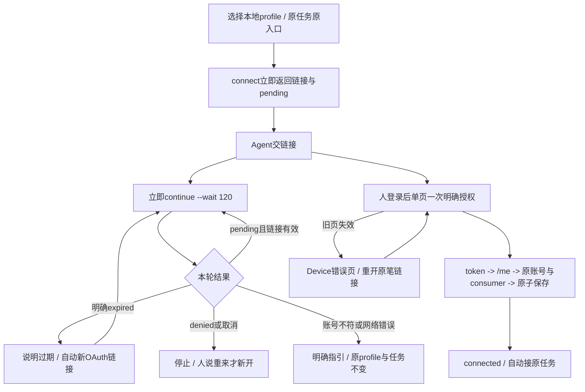

# ItPay CLI

一个 `itpay` 入口，两种按需读法。CLI、命令注册、打包与随包Skill的唯一源码在 `itpay-ai/cli`；API Hub和Services/Payment分别由独立Hub与compose-v4维护。

## 完整使用旅程（目标，未实施）

授权重建先实施；货架与一行调用在授权之后独立交付。本图包含现状证据，不表示目标命令已可用。

状态依据：11/05五宿主是CLI63；65独立original-receipt证据不代表五宿主通过。隔离账务/恢复检查只证明各自fixture范围；充值续接、供应商失败账务和新货架仍待完整验收。逐节点证据、命令输入输出、失败下一步与删除清单见完整合同。

[完整跨仓合同](https://github.com/itpay-ai/itpay_compose_v4/blob/codex/agent-connection-docs-20261106/docs/DEVELOPMENT.md#api-journey-contract)（待审分支，非现网操作指南）。

## 架构概览

逻辑职责图，不代表部署拓扑。新任务在宿主允许且能执行 CLI 时优先 CLI；CLI 直接调用 HTTP API，不经过 MCP。详见[完整架构](docs/ARCHITECTURE.md)。

## Agent 连接目标（待实施）

默认Device和多Agent独立连接尚未实现；当前正式setup/固定包不变。CLI/MCP独立凭据，无权限、过期、撤销联动；新任务双可用时CLI优先，原任务原入口。

架构与UX均为目标，不代表当前服务器或CLI可用。节点到源码、每轮120秒结果、旧页恢复/版本配对见[开发目标](docs/DEVELOPMENT.md#agent-connection-target)和[当前与目标边界](docs/ARCHITECTURE.md#agent-connection-architecture)。

- 办事、铁路/其他服务、订单和已购内容：读 [Services Skill](skills/itpay/SKILL.md)，按需 `itpay services --help` 或 [Services索引](docs/cli-reference/index.md)。无需先读API维护文档。
- 发现/调用API、用量与Hub任务恢复：读 [API Skill](skills/itpay-api/SKILL.md)，`itpay api --help` 和 [API参考](docs/cli-reference/api.md)。无需先读Services铁路教程。`hub`是同一API注册的兼容别名，首选api。

共用登录账号不代表资源、scope、设备登记、consumer或业务同意可互换。每次命令保留真实宿主声明、同Backend/Hub端点与获准状态目录；不清身份、换宿主或重建未知任务恢复额度。

实际发布、固定下载和验收候选分别按[发布](docs/RELEASE.md)与包source/hash核对，README不把历史固定版本当当前版本。现有包保留Services/API两Skill；新Device命令只有在批准候选交付后才写正式setup/Skill。

维护者：[架构](docs/ARCHITECTURE.md)、[合同](docs/CONTRACTS.md)、[开发](docs/DEVELOPMENT.md)、[发布](docs/RELEASE.md)、[测试](docs/TESTING.md)、[待办](docs/BACKLOG.md)。2026-10-28三产品源码整理已正常PR合并，部分真实子路径完成；购买/履约、自然宿主及完整旅程仍未验收。本地help/包检查和main合并均不代表服务器已部署或完整验收通过。

## 维护任务入口

维护者首次读 [AGENTS](AGENTS.md)，再按[任务导航](docs/DEVELOPMENT.md#按任务开工)找到owner、修改位置与验证。用户使用Services或API各自Skill即可。服务端部署组合在[V4部署矩阵](https://github.com/itpay-ai/compose-v4/blob/main/docs/DEPLOYMENT.md#可选源码组合与支持边界)：Hub为主、Services为主、完整组合的依赖和未支持项分别列明；源码合并不表示已部署。
