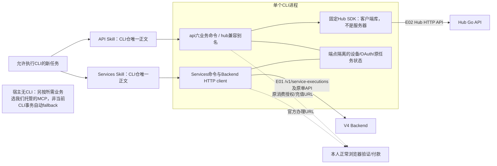
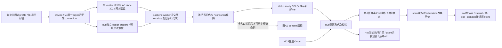
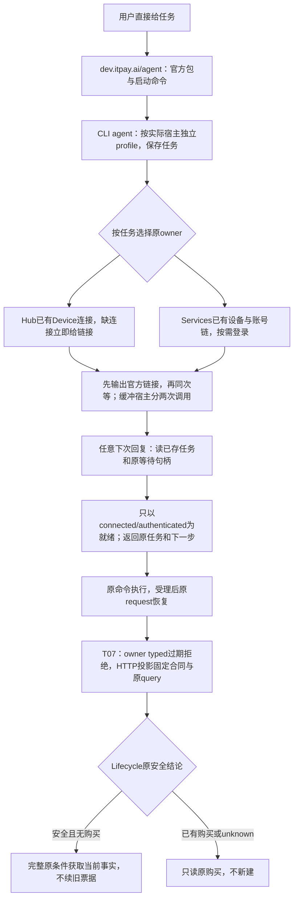
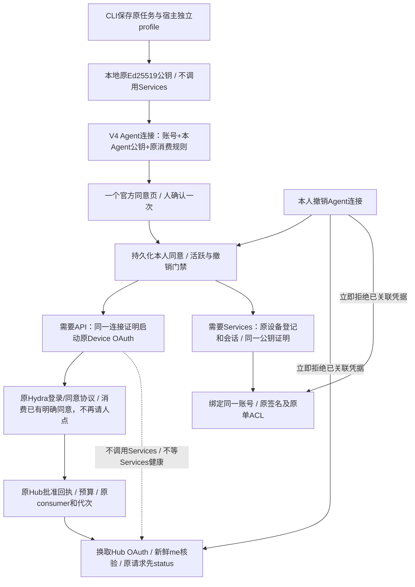

# CLI 架构

## 新任务入口选择

宿主允许且可执行官方固定CLI → 优先CLI → 按任务只读 Services 或 API Skill。无获准CLI能力 → 对应ItPay托管用户MCP或Hub MCP。平台强制流程/明确连接测试按实际能力执行；已受理/unknown任务保留原入口、身份、请求与权限，不因优先级重发。

## CLI详细逻辑调用

[Backend client](../src/client/backend.ts)直调V4业务HTTP，[Hub client](../src/client/hub.ts)配置固定SDK，[api命令](../src/commands/api_commands.ts)保留hub兼容别名。设备/OAuth与原任务状态按端点隔离；一个安装包不意味着token可跨资源。

[三仓总图与V4详图](https://github.com/itpay-ai/compose-v4/blob/main/docs/ARCHITECTURE.md)；[Hub详图](https://github.com/itpay-ai/itpay-api-hub/blob/main/docs/ARCHITECTURE.md)。图为源码逻辑，CLI不调用MCP；包生成和发布是不同事实。

本仓是唯一CLI源码家。`src/main.ts`保留Services、订单、内容与账户命令；`src/commands/api_commands.ts`统一注册api及hub兼容别名；`src/client/hub.ts`是固定SDK的薄配置层。CLI API使用独立Hub合同/SDK调用Hub API，CLI Services直接调用V4 API，均不经MCP；不能为宿主复制业务状态机或直接解释供应商结果成付款/权限事实。

Services设备状态与Hub OAuth/Key、task ledger分别按当前端点保存。共同的ITPAY_STATE_DIR只提供受控存储位置，不把不同issuer/resource/token合并。真实Agent Type、Backend、Hub URL、launcher和状态目录在每个命令继承；setup参数不保证下个shell已继承。

`skills/itpay`是Services入口；`skills/itpay-api`面向API任务。按需reference提供参数，Buyer JSON为正式运行输入，不能当旧报告清除。源码Seller能力不等于当前Buyer安装包开放sell；不在正常帮助引导未打包入口。

构建为Node18+ Buyer ESM，发布制品包括正式Skill/Buyer JSON/按命令参考和许可声明；Hub SDK从dependencies固定tgz打入bundle，没有可编辑vendor副本。机器声明在package/lock、SDK.source.json和release_identity.ts，文档不改这些版本。两份Skill和API参考页均入本地候选；API reader独立校验包内摘要/名称并忽略Services覆盖目录，不写身份或访问网络。未完成的自然体验见[待办](BACKLOG.md)。

删除前检查注册、CLI内部reader、随包文件清单、包测试和现有用户恢复状态；命令别名与字段不能仅靠文档消失。owner边界和变化规则见[合同](CONTRACTS.md)。

## Agent 连接与授权代次

新普通Agent无默认周期限额，旧显式和APIKey预算保持；CLI/MCP独立授权。profile与可信连接分开；同页双owner同意、稳定consumer代次和原请求接续见[开发合同](DEVELOPMENT.md#agent-connection-target)。CLI loopback删除，MCP HTTPS callback/PKCE及Services链保持。

## N6.3：当前断点与本阶段第一批

原断点：首次expiry的HTTP裸错误丢恢复信息、launcher拒绝重复profile、setup需人工拼装。本阶段已实现CLI/Skill接入和T07安全投影，Hub和Services仍独立授权，保留两套权限owner、预算、旧profile和原请求。CLI不执行自然语言任务，持久保存原意交还宿主；不将安装/链接/进程退出0称为授权或业务成功。第二批统一同意页/按需双签发尚未实施。

## N6.3 第二批：一次同意、按需凭据（开发服已实现）

开发服新安装使用 V4 持久同意记录，旧独立连接保留原路径。这，不是新身份或令牌系统：账号仍由V4登录，Hub令牌仍由Hydra签发、预算仍归Hub，Services仍用原设备签名和会话。未请求的业务不登记设备、不换取其凭据；旧profile/已受理或unknown任务不迁移。普通新连接的默认单次和旧显式预算沿原规则，不隐式付款。共享同意不共享token/resource/grant，也不把Services失败放进API就绪条件。
