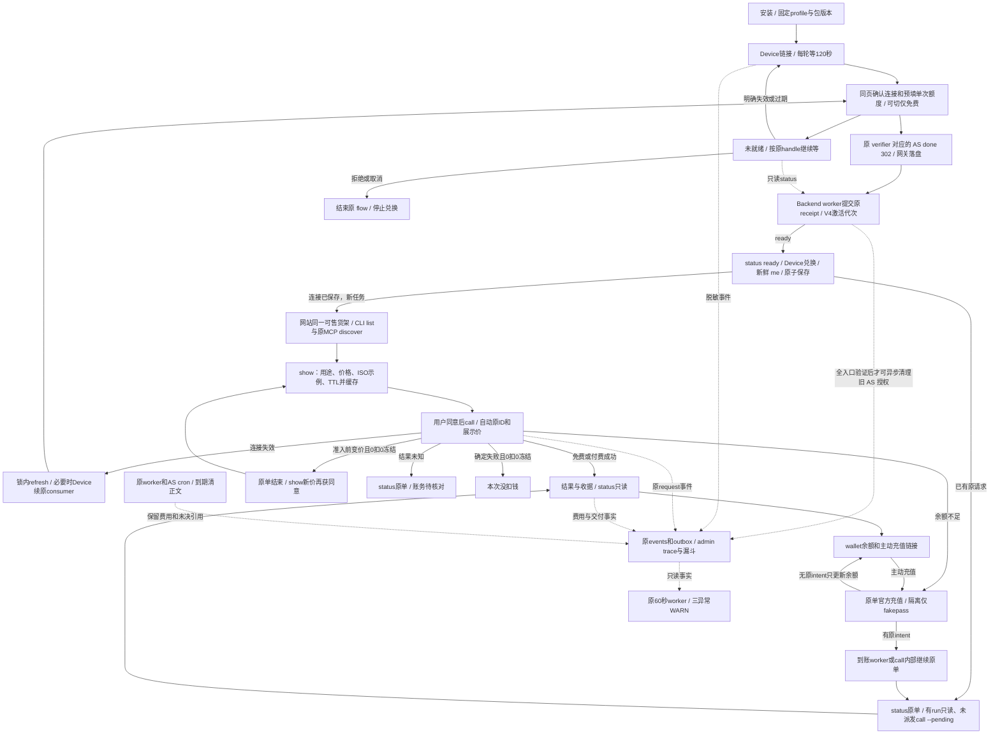

# CLI 开发

先读[架构](ARCHITECTURE.md)、[合同](CONTRACTS.md)和对应reference。Services/API两个用户入口独立；保持R3宿主上下文、身份锁、原任务幂等与unknown保护。复用已有模块/测试，不扩建编排器或测试框架。

依赖按package-lock冻结：`npm ci --ignore-scripts`；必要构建 `npm run build`。常规改动跑相称定点测试；打包相关用 `npm run test:package`（已有打包/隔离安装/合成API smoke），完整发布检查是 `npm run check`。不因文档变更重跑无关大矩阵，也不把未跑检查写绿。

Hub SDK只从精确dependencies包及source.json升级，核commit/version/合同digest/hash和离线consumer；不复制Hub源码或修改生成类型来掩盖合同差异。版本/API身份归release_identity和发布流程，不由README改变。

删除旧说明前核src reader、命令help、package.files、scripts/package-smoke映射、测试和打包资源；仍消费的Buyer JSON与当前命令页保留。路径和真实help核对后再删未开放sell/过期rollout指南，不能顺手删除代码/测试。

main经PR；说明具体目标、变更、验证/未观察项。删除能力必须列替代与消费者迁移。当前治理自动检查/branch protection是否已启用需核实，规则文字不是已强制执行证据。除CLI next既有专项批准范围外，Actions每次明确授权，见[政策](../.github/ACTIONS_POLICY.md)。发布、版本号与渠道另见[发布](RELEASE.md)。

## 给 Frank 和后续开发者

从最新main开分支，按当前任务正常开发/相称验证/PR审查和获准合并；部署、迁移、版本/渠道、域名、真实交易与Actions另核授权，不复用旧阶段禁令或无限延续历史批准。CLI只改命令/输出/打包与两Skill，业务归属见[架构](ARCHITECTURE.md)，固定Hub SDK变更由Hub生成制品后显式更新消费者锁。

Services命令直接调用V4 API，API命令用固定Hub SDK→Hub API，都不经MCP；用户MCP16工具另走SDK→Hub→受信委托V4，开发者Hub MCP又是独立入口。SDK不是MCP服务器，不混resource/consumer/grant或宣称两个入口已完整等价验收。用户按[Services Skill](../skills/itpay/SKILL.md)与[API Skill](../skills/itpay-api/SKILL.md)分别进入；[测试](TESTING.md)是注明日期的证据，[发布](RELEASE.md)另列实际包/渠道，main与dist不自动等于已发布/部署。

## 按任务开工

README → AGENTS → 本表对应正文；用户Agent按任务只读一个Skill，不要求读维护文档。

| 任务 | owner与修改入口 | 必要验证/下一入口 |
|---|---|---|
| Services命令、状态/原单恢复、两Skill/帮助 | 本仓 `src/main.ts`、`src/client/backend.ts`、`skills/itpay`、`docs/agent/buyer` | [合同](CONTRACTS.md)、原目标tests，typecheck；Skill用原build生成完整性标识、test:package |
| API命令/OAuth任务恢复 | 本仓 `src/commands/api_commands.ts`、`src/client/hub.ts`、`skills/itpay-api` | [API参考](cli-reference/api.md)、[架构](ARCHITECTURE.md)、原API tests与包检查 |
| Services业务、用户Web/landing/MCP卡片、账号authority | 独立V4 | [V4开发导航](https://github.com/itpay-ai/compose-v4/blob/main/docs/DEVELOPMENT.md#按任务开工)；不在CLI增加业务owner |
| Hub Console/MCP/钱包、SDK/合同 | 独立Hub | [Hub开发导航](https://github.com/itpay-ai/itpay-api-hub/blob/main/docs/DEVELOPMENT.md#按任务开工)；提供方生成固定包，CLI显式消费 |
| 构建/安装包/npm | 本仓 `scripts/build-buyer.mjs`、`package.json`、[RELEASE](RELEASE.md) | 私有未发布候选检查与发布不同；版本/渠道/Actions按当前任务授权 |
| 服务端组合部署 | V4装配，Hub独立源码制品 | [V4部署](https://github.com/itpay-ai/compose-v4/blob/main/docs/DEPLOYMENT.md#可选源码组合与支持边界)，CLI合并不部署服务 |

CLI不经MCP。用户MCP与Hub MCP各有自己的工具/卡片及client/resource/grant；共同Buyer不合并设备、OAuth或网页session。已受理/unknown仅沿原任务恢复，不能用换入口绕权限。

Charlie已长期批准CLI next发布workflow：在已批准候选/版本范围内无需逐次申请Actions权限；不扩到新版本号、latest、V4部署或其他CI。本次文档任务不运行Actions或发布。


<a id="agent-connection-target"></a>
## 授权与连接（目标，未实施）

Charlie已定新普通Agent无默认周期上限、保留可信单次同意；旧显式额度与API Key预算保持。先授权重建，货架后独立交付。授权实现使用同页批准和稳定连接代次，独立宿主验收使用固定配对候选。CLI/MCP凭据独立，无权限、过期、撤销联动；原任务原入口。

同宿主两会话默认共享安装profile、连接及该安装尚未完成的auth_handle，connect在锁内复用它；业务request ID各自独立。不同Agent各自随机安装ID；selector与精确路径见后面的13项合同。legacy归原使用者，新Agent新profile授权。

Device connect交链接后立即`connect continue --wait 120 -- <handle>`；pending有效继续等，expired自动新OAuth链接，拒绝/取消停止到用户说重来；错账号给本人可信脱敏账号和切换入口；网络未知保留原handle。网页同页显示 Agent 与设备，默认单次 ¥0.01，原任务按已展示报价预填，用户可修改金额或切换仅免费；两owner独立记账，全部就绪、token→/me核验并原子保存后CLI才说已连接。旧页错误由gateway接Device专用风格页，按钮重开原笔链接；验A失效→重开A→A/B均connected。

目标 CLI 先查同一 handle 的 status，ready 后才锁内兑换。pending 可跨进程保存原 proof/code，候选 token 仅内存。首次 /me 新鲜核验原绑定后原子保存。兑换不明先核原 flow，已消费且未保存则重新同意，保原业务。

V4去Reserve/Activate互相expire与单active索引，grant reference唯一保留。connection身份PK查询；created_at/ID keyset列表默认50、最多100条。设备展示名、Agent类型、AS consent ID及授权代次见身份合同。CLI loopback旧分支删除；Hub/MCP的HTTPS callback、PKCE和Services设备链保持。

<a id="api-journey-contract"></a>
## API首版合同（目标，未实施）



公共规则：api/hub同组，业务只有六命令；安装/连接另列。专属launcher自动选择selector，每个next同时携`--profile /绝对路径/api-profile.json`。以下JSON中的路径是目标安装示例。profile只选本地状态，不授服务端权限。金额为CNY scale6 atoms字符串；未知结果沿原account/key/consumer读原请求。

### categories
参数：`api categories [--json]`。网站同一reader列真实分类和空架。
```json
{"status":"listed","result":{"items":[{"id":"category_cec3a9b89b2e391393d0f68e","name":"数据","slug":"Data","count":1}]},"next":{"command":"itpay api --profile /Users/tzz/.local/share/itpay/hosts/codex-desktop/api-profile.json list --category category_cec3a9b89b2e391393d0f68e --json"}}
```
next：选分类→list；读取失败→原命令重试。

### list
参数：`api list [--category <真实ID/slug/标签>] [--query <1..200字符>] [--limit <1..100，默认20>] [--cursor <opaque，最多1024字符>] [--json]`；省类别=全部可售，重名返回候选。
```json
{"status":"listed","result":{"items":[{"id":"op_827bbbc019ca229e06dab0e234f72d5f","name":"Frankfurter汇率","purpose":"读取指定货币对每日参考汇率","price":"¥0.01/次"}],"page":{"next_cursor":null}},"next":null}
```
next：选商品→show；空架→其他分类；错误→重试。商品仅四字段，服务端先过滤再分页。

### show
参数：`api show <operation_id，1..200字符> [--json]`。缓存按profile、Hub origin、operation、publication分别存；同operation展示指针在本profile锁内原子更新。
```json
{"status":"shown","result":{"id":"op_5dbe7c963383f7699fc3807ed0665bb6","purpose":"按UTC时间段及最低震级查询全球地震","price":"免费","ttl_days":7,"example_input":{"query_starttime":"2026-11-05T00:00:00Z","query_endtime":"2026-11-06T00:00:00Z","query_format":"geojson","query_limit":100,"query_minmagnitude":4,"query_nodata":404}},"next":null}
```
next：Agent告知用途/价格/TTL、取得用户同意后call。USGS给合法固定ISO一行例子，并说明查最近24小时应按当前UTC替换start/end；没有动态Node命令。未上架→list。

### call
参数：正常仅`api call <id> --input '<JSON object>' [--json]`，支持@file/stdin。原ID、展示价max_charge与每轮120秒等待内部处理；直接取show缓存提交，不二次inspect。无show→一句“先show查看用途和价格”。缓存与publication同寿命，不加报价有效期层；变价由服务端门禁拒绝，输入按缓存schema及服务端校验。
```json
{"status":"succeeded","result":{"request_id":"req_example","run_id":"run_example","captured_atoms":"10000","held_atoms":"0","result":{"example":"supplier result"},"result_expires_at":"2026-11-13T10:00:00Z"},"next":{"command":"itpay api --profile /Users/tzz/.local/share/itpay/hosts/codex-desktop/api-profile.json status req_example --json"}}
```
next：成功→status；连接失效→同profile锁内refresh或Device续原consumer；缺消费同意→同页明确付费选择；余额不足→原单官方fakepass页并等原单；准入前变价且0/0→show新价；未知→status。

### status
参数：`api status <request_id，1..128字符> [--json]`；只GET原request/run，兼原收据与保存结果。
```json
{"status":"pending","result":{"request_id":"req_example","execution_state":"unknown","settlement_state":"reconciling","held_atoms":"10000","captured_atoms":null},"next":{"command":"itpay api --profile /Users/tzz/.local/share/itpay/hosts/codex-desktop/api-profile.json status req_example --json"}}
```
next：pending/unknown→同status；过期→仍读费用；401→connect原profile后读原单；404→核原连接或owner网页。此命令无续跑/扣款副作用。

### wallet
参数：`api wallet [--json]`；服务端同时给主动充值入口。
```json
{"status":"ready","result":{"available_atoms":"100000","held_atoms":"0","currency":"CNY","scale":6,"period_limit_atoms":null,"topup_url":"https://dev.itpay.ai/me/wallet"},"next":null}
```
next：主动充值打开该官方链接；已有blocked则附原intent链接；显式累计额度耗尽由owner处理，充值不增加它。

## 原单接续与资金

call先落盘原ID、publication、价格和输入；内部恢复形式仅`api call --pending <本profile handle>`，与新id/input互斥。每轮先读原单：已有run只读，无run且官方条件完成才一次Continue。到账worker每5秒以原actor调用ContinueQueued。重连必须先保原consumer，再查原单；自动更新OAuth不创建替代业务。宿主暂停后由Agent执行原next，CLI本身不唤醒宿主。

Admit复核expected_publication_id、max_charge和当前grant；变价时，原单确认无run/attempt/reservation/capture后在runs owner事务中结束blocked intent，保留digest，提示新价与“本次没扣钱”；随后新show、同意、新call。已有run/派发未知/仍held先核对原结算。确定失败0扣0冻结才说没扣钱；unknown/reconciling说待核对；captured但结果读失败只读原结果。结果按原request取回，实际TTL7/7/1天，过期仍读费用。


十三项具体机制、字段/接口、数值、owner与分期统一见[跨仓合同](https://github.com/itpay-ai/compose-v4/blob/codex/agent-connection-docs-20261106/docs/DEVELOPMENT.md#connection-13-contract)。本仓只在表中唯一owner实施。


### CLI Device 授权入口

`setup --api-prefix <绝对目录>` 创建当前安装的私有选择文件与启动器。`api --profile <选择文件> connect` 返回授权链接和原等待命令，`connect continue --wait 120 -- <handle>` 接着等待，`connect status` 显示当前安装和代次。续接带已有本地请求时传 `connect --request <request_id>`，连上后先读原单。已确认兑换但本地未保存时，由本人选择 `connect restart` 恢复同一连接。旧连接私有恢复候选由 connect 在原绑定内处理，不保留独立业务恢复注册。

在本地候选配对中，Device 客户端向配置的 issuer 启动和轮询，并在 ready 后用标准 Device grant 兑换；首次 `/me` 的买家、consumer、批准和代次一致才写私有凭据。失败或重连继续使用原安装。

### N62 报价事件关联

`api show` 缓存 Hub 的可选 `shown_event_id`，新 call 将该引用与原 publication/输入/最高费用一起保存并发送；一个 show 可关联多个不同原 request。该元数据不进入幂等摘要，不改固定 SDK、权限、扣费或续接算法。继续和 status 保持原 request，服务端从原事件恢复充值 parent；没有报价引用的旧记录仍可读，不补造 show。事件与只读查询合同以 Hub DEVELOPMENT 的 N62 表为准。

## 当前首次连接

agent 保存原任务后使用现有统一确认页，主项与默认可取消副项；setup 准备安装并给出同一连接入口，auth login/api connect 原地等待。旧凭据和 accepted/unknown 原单保持原恢复动作；托管 MCP 各自正常 OAuth，不能把共享浏览器登录等同共享权限。当前交付仅见 README/DEPLOYMENT。

## 合并前 Codex 审查

最后待合并 revision 必须取得 Codex 的明确审查结论；沿现有 GitHub Codex Review 渠道（需要时在 PR 请求 `@codex review`）。先处理全部可操作意见并提供回归证据，再对最终 revision 取得结论后正常合并。新提交使旧结论失效；仅解决线程、没有评论、审查仍在运行、不可用或配额耗尽都不算通过。遇到渠道不可用/配额限制，告知 Planning，保留 PR 不合并，不绕过保护，不新建 Actions 或审批服务。
