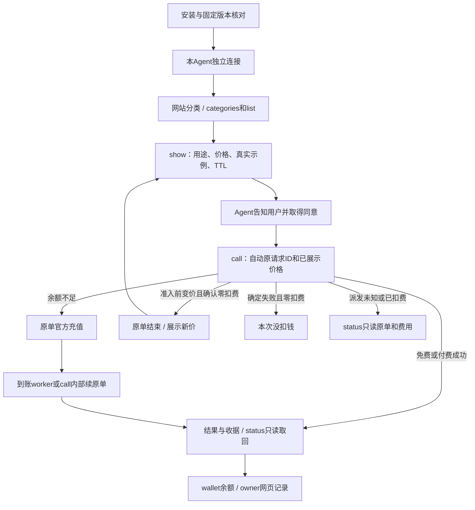

# CLI 开发

先读[架构](ARCHITECTURE.md)、[合同](CONTRACTS.md)和对应reference。Services/API两个用户入口独立；保持R3宿主上下文、身份锁、原任务幂等与unknown保护。复用已有模块/测试，不扩建编排器或测试框架。

依赖按package-lock冻结：`npm ci --ignore-scripts`；必要构建 `npm run build`。常规改动跑相称定点测试；打包相关用 `npm run test:package`（已有打包/隔离安装/合成API smoke），完整发布检查是 `npm run check`。不因文档变更重跑无关大矩阵，也不把未跑检查写绿。

Hub SDK只从精确dependencies包及source.json升级，核commit/version/合同digest/hash和离线consumer；不复制Hub源码或修改生成类型来掩盖合同差异。版本/API身份归release_identity和发布流程，不由README改变。

删除旧说明前核src reader、命令help、package.files、scripts/package-smoke映射、测试和打包资源；仍消费的Buyer JSON与当前命令页保留。路径和真实help核对后再删未开放sell/过期rollout指南，不能顺手删除代码/测试。

main经PR；说明具体目标、变更、验证/未观察项。删除能力必须列替代与消费者迁移。当前治理自动检查/branch protection是否已启用需核实，规则文字不是已强制执行证据。除CLI next既有专项批准范围外，Actions每次明确授权，见[政策](../.github/ACTIONS_POLICY.md)。发布、版本号与渠道另见[发布](RELEASE.md)。

## 给 Frank 和后续开发者

从最新main开分支，按当前任务正常开发/相称验证/PR审查和获准合并；部署、迁移、版本/渠道、域名、真实交易与Actions另核授权，不复用旧阶段禁令或无限延续历史批准。CLI只改命令/输出/打包与两Skill，业务归属见[架构](ARCHITECTURE.md)，固定Hub SDK变更由Hub生成制品后显式更新消费者锁。

Services命令直接调用V4 API，API命令用固定Hub SDK→Hub API，都不经MCP；用户MCP16工具另走SDK→Hub→受信委托V4，开发者Hub MCP又是独立入口。SDK不是MCP服务器，不混resource/consumer/grant或宣称两个入口已完整等价验收。用户按[Services Skill](../skills/itpay/SKILL.md)与[API Skill](../skills/itpay-api/SKILL.md)分别进入；[测试](TESTING.md)是注明日期的证据，[发布](RELEASE.md)另列实际包/渠道，main与dist不自动等于已发布/部署。

## 按任务开工

README → AGENTS → 本表对应正文；用户Agent按任务只读一个Skill，不要求读维护文档。

| 任务 | owner与修改入口 | 必要验证/下一入口 |
|---|---|---|
| Services命令、状态/原单恢复、两Skill/帮助 | 本仓 `src/main.ts`、`src/client/backend.ts`、`skills/itpay`、`docs/agent/buyer` | [合同](CONTRACTS.md)、原目标tests，typecheck；Skill用原build生成完整性标识、test:package |
| API命令/OAuth任务恢复 | 本仓 `src/commands/api_commands.ts`、`src/client/hub.ts`、`skills/itpay-api` | [API参考](cli-reference/api.md)、[架构](ARCHITECTURE.md)、原API tests与包检查 |
| Services业务、用户Web/landing/MCP卡片、账号authority | 独立V4 | [V4开发导航](https://github.com/itpay-ai/compose-v4/blob/main/docs/DEVELOPMENT.md#按任务开工)；不在CLI增加业务owner |
| Hub Console/MCP/钱包、SDK/合同 | 独立Hub | [Hub开发导航](https://github.com/itpay-ai/itpay-api-hub/blob/main/docs/DEVELOPMENT.md#按任务开工)；提供方生成固定包，CLI显式消费 |
| 构建/安装包/npm | 本仓 `scripts/build-buyer.mjs`、`package.json`、[RELEASE](RELEASE.md) | 私有未发布候选检查与发布不同；版本/渠道/Actions按当前任务授权 |
| 服务端组合部署 | V4装配，Hub独立源码制品 | [V4部署](https://github.com/itpay-ai/compose-v4/blob/main/docs/DEPLOYMENT.md#可选源码组合与支持边界)，CLI合并不部署服务 |

CLI不经MCP。用户MCP与Hub MCP各有自己的工具/卡片及client/resource/grant；共同Buyer不合并设备、OAuth或网页session。已受理/unknown仅沿原任务恢复，不能用换入口绕权限。

Charlie已长期批准CLI next发布workflow：在已批准候选/版本范围内无需逐次申请Actions权限；不扩到新版本号、latest、V4部署或其他CI。本次文档任务不运行Actions或发布。


<a id="agent-connection-target"></a>
## 授权与连接（目标，未实施）

先授权重建，再独立交付货架；Charlie确认后实施。CLI当前默认callback，固定下载包保持现状。新任务双入口可用时CLI优先，原任务原入口；CLI与MCP无权限、过期、撤销联动，MCP授权流程保持。

每Agent安装入口持久随机profile ID；credentials/pending/locks/tasks均在该profile，Services原状态保留。legacy由原来使用它的Agent继续使用，新Agent新profile、新授权。历史共享归属不明时保留原文件和原任务，不推断或迁移。

Device connect立即返回链接和handle，Agent交链接后执行`connect continue <handle> --wait 120`。interval/slow_down持久化；同handle串行poll，sleep不持全局锁。interval=5秒时120秒约24次poll，slow_down逐步降低频率；这是估算。宿主停执行后由原可恢复调用继续等待。

|结果|Agent / 浏览器 / next|
|---|---|
|connected|token→/me→原Buyer/consumer核验→原子保存；CLI“已连接”，网页“已授权，回到Agent”，自动接原任务|
|pending且有效|“还在等你授权，链接仍有效”；继续下一轮120秒|
|expired|“链接已过期”；自动新OAuth链接，网页提示回Agent|
|denied/cancelled|“已取消，已停止”；用户说重来才新发|
|account_mismatch|本人可信脱敏当前/期望账号及切换入口，保留原任务|
|旧页失效|gateway仅Device verify错误回本站风格页，按钮重开该笔原链接；MCP及CSRF保持|
|network_error|保留原handle/profile，原轮重试|

V4 Reserve/Activate去互相expire和单active唯一索引，保留grant_ref唯一；新增nullable consent ID、Agent类型、设备展示名。鉴权按PK精确查；账号列表created_at/ID keyset，默认50、最多100条并加索引。管理网页后置。显示标签不是身份凭证。

<a id="api-journey-contract"></a>
## API首版合同（目标，未实施）



公共规则：`api`与`hub`同一命令组；固定profile持久端点与凭据，next为短命令。JSON沿现envelope，金额为CNY scale6整数atoms字符串。身份按原account/key/consumer；资金事实不明先读原单。安装/连接命令与下列六业务命令分开。

### categories
参数：`api categories [--json]`。从网站同一taxonomy reader列全部实际分类，空分类count=0。
```json
{"status":"listed","result":{"items":[{"id":"category_cec3a9b89b2e391393d0f68e","name":"数据","slug":"Data","count":2}]},"next":{"command":"itpay api list --category category_cec3a9b89b2e391393d0f68e --json"}}
```
next：选择分类→list；读取失败→原categories重试。

### list
参数：`api list [--category <ID或真实slug或标签>] [--query <1..200字符>] [--limit <1..100，默认20>] [--cursor <opaque，最多1024字符>] [--json]`；省略category=全部可售API，重名返回候选。
```json
{"status":"listed","result":{"items":[{"id":"op_827bbbc019ca229e06dab0e234f72d5f","name":"Frankfurter汇率","purpose":"读取指定货币对的每日参考汇率","price":"¥0.01/次"}],"page":{"next_cursor":null}},"next":{"command":"itpay api show op_827bbbc019ca229e06dab0e234f72d5f --json"}}
```
next：商品→show；空架→其他分类；目录错误→重试。商品仅四字段，分页在外层，服务端过滤后分页。

### show
参数：`api show <operation_id，1..200字符> [--json]`；读取后缓存本profile、operation、publication对应的价格及示例，按operation另存已展示指针，并发采用文件锁和原子写。
```json
{"status":"shown","result":{"id":"op_827bbbc019ca229e06dab0e234f72d5f","purpose":"读取EUR/USD每日参考汇率，非实时交易报价","price":"¥0.01/次","ttl_days":7,"example":"itpay api call op_827bbbc019ca229e06dab0e234f72d5f --input '{\"path_base\":\"EUR\",\"path_quote\":\"USD\"}'"},"next":null}
```
next：Agent告知用途、价格、TTL，获同意后call；未上架→返回list。每个上架商品须有合法公共输入的可复制示例。

### call
参数：正常仅`api call <operation_id> --input '<JSON object>' [--json]`，支持现有@file/stdin；schema本地及服务端验证。原请求ID生成并落盘、max_charge取已展示价、每轮120秒等待均在内部。
```json
{"status":"succeeded","result":{"request_id":"req_example","run_id":"run_example","captured_atoms":"10000","held_atoms":"0","result":{"example":"supplier result"},"result_expires_at":"2026-11-13T10:00:00Z"},"next":{"command":"itpay api status req_example --json"}}
```
next：成功→status取原结果；未show→“先show查看用途和价格”；余额不足→原intent官方页并继续内部等待；缺消费批准→原consumer owner消费页，批准后原call内部接续；变价且零扣费→show新价并重新取得同意；未知/仍held→status原单。

### status
参数：`api status <request_id，1..128字符> [--json]`；纯GET原请求及原run，可取收据和保存结果。
```json
{"status":"pending","result":{"request_id":"req_example","execution_state":"unknown","settlement_state":"reconciling","held_atoms":"10000","captured_atoms":null},"next":{"command":"itpay api status req_example --json"}}
```
next：pending/unknown→同status；结果过期→费用事实仍可读；404→核原profile或owner网页。此命令没有执行/扣费副作用。

### wallet
参数：`api wallet [--json]`；读共享账户钱包，显式预算存在时另列。
```json
{"status":"ready","result":{"available_atoms":"100000","held_atoms":"0","currency":"CNY","scale":6,"period_limit_atoms":null},"next":null}
```
next：有原blocked请求→原官方动作；显式周期额度耗尽→“授权额度已用完，充值不会增加额度”，由owner处理；查询错误→重试而非余额0。

## 自动原单接续

首版没有第七个业务resume。`call`首次落盘request ID及冻结输入/价格，再入Admit；遇blocked保留同一handle并等待官方动作。每轮先GET原请求，已有run只读；到账worker用原actor执行ContinueQueued。授权完成但尚无run时，call内部按原intent做一次Continue，随后只轮询原run。新一轮进程只由返回的恢复动作`api call --pending <本profile handle>`进入，参数与新id/input互斥：读取已有任务、原账号/consumer、原输入和原id，复核授权再继续，不重新Admit新单。该高级恢复形式仅在机器next出现，普通show→call教程没有额外flags。等待进程活着则无需人再发命令；宿主暂停后由Agent执行原next，不宣称CLI能唤醒宿主。

服务端仍以Admit的expected_publication_id和max_charge校验价格，resolveSpendingGrant/validateCallerGrant复核consumer、scope/effect、有效期及单次额度，Billing.Reserve锁钱包和实际预算。现有有效grant内调用无需重新OAuth；没有可信批准则走现owner消费批准页。

## 变价结束原单

现Admit在插run/冻结前对比publication，差异返回publication_changed；Continue用原snapshot重入Admit，当前失败分支会把resuming恢复open。拟最小修改是在同一runs owner将该变价分支事务化：锁原intent，确认没有run、provider attempt、reservation/charge后标cancelled、blocking_reason=publication_changed，保留原digest与读取引用；同事务中续接竞争者须再验intent状态。新价格从当前descriptor读取返回。无需新HTTP业务接口。

原单确认capture0、held0后提示“价格已变，本次没扣钱”；show新价→用户同意→新的call生成新ID。若已有run、派发未知或冻结尚未释放，先读原run结算，继续原请求核对。已知失败释放后可明确新请求，不改写旧publication。

## 结果与费用

show显示实际TTL；结果按原request/run取回，与同operation/input的新鲜查询区分。首版三商品分别7/7/1天；过期只读费用事实。确定失败且capture0、held0显示“本次没扣钱”；unknown/reconciling显示“结果和费用待核对，当前冻结¥X”；captured但读结果失败显示“已扣¥X，正在读取原结果”。完整记录首版走现owner网页；records命令及Hub MCP新商品工具下一期。


完整分类、商品清理、额度源码结论和逐文件删除表见[跨仓完整设计](https://github.com/itpay-ai/compose-v4/blob/codex/agent-connection-docs-20261106/docs/DEVELOPMENT.md#api-journey-contract)。本仓按其中owner表实施。
