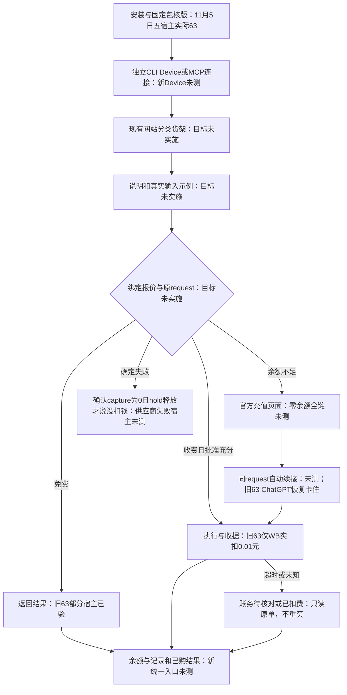
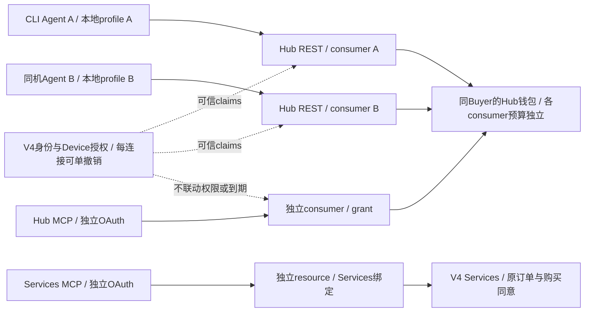
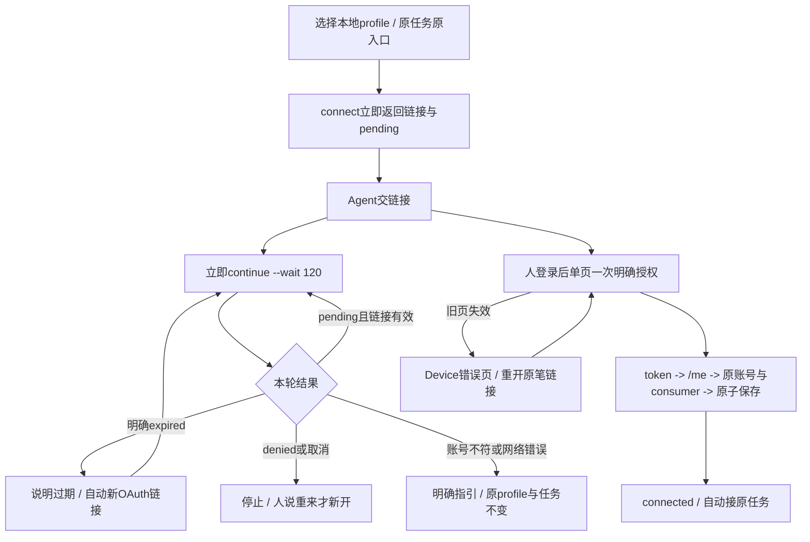

# CLI 开发

先读[架构](ARCHITECTURE.md)、[合同](CONTRACTS.md)和对应reference。Services/API两个用户入口独立；保持R3宿主上下文、身份锁、原任务幂等与unknown保护。复用已有模块/测试，不扩建编排器或测试框架。

依赖按package-lock冻结：`npm ci --ignore-scripts`；必要构建 `npm run build`。常规改动跑相称定点测试；打包相关用 `npm run test:package`（已有打包/隔离安装/合成API smoke），完整发布检查是 `npm run check`。不因文档变更重跑无关大矩阵，也不把未跑检查写绿。

Hub SDK只从精确dependencies包及source.json升级，核commit/version/合同digest/hash和离线consumer；不复制Hub源码或修改生成类型来掩盖合同差异。版本/API身份归release_identity和发布流程，不由README改变。

删除旧说明前核src reader、命令help、package.files、scripts/package-smoke映射、测试和打包资源；仍消费的Buyer JSON与当前命令页保留。路径和真实help核对后再删未开放sell/过期rollout指南，不能顺手删除代码/测试。

main经PR；说明具体目标、变更、验证/未观察项。删除能力必须列替代与消费者迁移。当前治理自动检查/branch protection是否已启用需核实，规则文字不是已强制执行证据。除CLI next既有专项批准范围外，Actions每次明确授权，见[政策](../.github/ACTIONS_POLICY.md)。发布、版本号与渠道另见[发布](RELEASE.md)。

## 完整使用旅程（目标，未实施）

授权重建先实施；货架与一行调用在授权之后独立交付。本图包含现状证据，不表示目标命令已可用。

状态依据：11/05五宿主是CLI63；65独立original-receipt证据不代表五宿主通过。隔离账务/恢复检查只证明各自fixture范围；充值续接、供应商失败账务和新货架仍待完整验收。逐节点证据、命令输入输出、失败下一步与删除清单见完整合同。

[完整跨仓合同](https://github.com/itpay-ai/itpay_compose_v4/blob/codex/agent-connection-docs-20261106/docs/DEVELOPMENT.md#api-journey-contract)（待审分支，非现网操作指南）。

## 给 Frank 和后续开发者

从最新main开分支，按当前任务正常开发/相称验证/PR审查和获准合并；部署、迁移、版本/渠道、域名、真实交易与Actions另核授权，不复用旧阶段禁令或无限延续历史批准。CLI只改命令/输出/打包与两Skill，业务归属见[架构](ARCHITECTURE.md)，固定Hub SDK变更由Hub生成制品后显式更新消费者锁。

Services命令直接调用V4 API，API命令用固定Hub SDK→Hub API，都不经MCP；用户MCP16工具另走SDK→Hub→受信委托V4，开发者Hub MCP又是独立入口。SDK不是MCP服务器，不混resource/consumer/grant或宣称两个入口已完整等价验收。用户按[Services Skill](../skills/itpay/SKILL.md)与[API Skill](../skills/itpay-api/SKILL.md)分别进入；[测试](TESTING.md)是注明日期的证据，[发布](RELEASE.md)另列实际包/渠道，main与dist不自动等于已发布/部署。

## 按任务开工

README → AGENTS → 本表对应正文；用户Agent按任务只读一个Skill，不要求读维护文档。

| 任务 | owner与修改入口 | 必要验证/下一入口 |
|---|---|---|
| Services命令、状态/原单恢复、两Skill/帮助 | 本仓 `src/main.ts`、`src/client/backend.ts`、`skills/itpay`、`docs/agent/buyer` | [合同](CONTRACTS.md)、原目标tests，typecheck；Skill用原build生成完整性标识、test:package |
| API命令/OAuth任务恢复 | 本仓 `src/commands/api_commands.ts`、`src/client/hub.ts`、`skills/itpay-api` | [API参考](cli-reference/api.md)、[架构](ARCHITECTURE.md)、原API tests与包检查 |
| Services业务、用户Web/landing/MCP卡片、账号authority | 独立V4 | [V4开发导航](https://github.com/itpay-ai/compose-v4/blob/main/docs/DEVELOPMENT.md#按任务开工)；不在CLI增加业务owner |
| Hub Console/MCP/钱包、SDK/合同 | 独立Hub | [Hub开发导航](https://github.com/itpay-ai/itpay-api-hub/blob/main/docs/DEVELOPMENT.md#按任务开工)；提供方生成固定包，CLI显式消费 |
| 构建/安装包/npm | 本仓 `scripts/build-buyer.mjs`、`package.json`、[RELEASE](RELEASE.md) | 私有未发布候选检查与发布不同；版本/渠道/Actions按当前任务授权 |
| 服务端组合部署 | V4装配，Hub独立源码制品 | [V4部署](https://github.com/itpay-ai/compose-v4/blob/main/docs/DEPLOYMENT.md#可选源码组合与支持边界)，CLI合并不部署服务 |

CLI不经MCP。用户MCP与Hub MCP各有自己的工具/卡片及client/resource/grant；共同Buyer不合并设备、OAuth或网页session。已受理/unknown仅沿原任务恢复，不能用换入口绕权限。

Charlie已长期批准CLI next发布workflow：在已批准候选/版本范围内无需逐次申请Actions权限；不扩到新版本号、latest、V4部署或其他CI。本次文档任务不运行Actions或发布。

## Agent 连接目标（待实施）

**状态：目标设计，尚未实现；本次只改文档。** 当前CLI仍默认本机callback，正式固定下载/Skill不提供下列拟命令。Hub #34是独立已验候选；本docs分支不包含其产品补丁，不部署、不发CLI、不改固定下载包、不运行Actions。

已定：同账号多设备/多Agent独立连接，本地profile/pending、consumer、grant和撤销独立；共Hub钱包，不复制预算。新任务双入口真实可用时CLI优先；原任务原入口/consumer。CLI与MCP无权限、过期、撤销联动，MCP授权流程不改。默认Device每轮`--wait 120`，有效pending继续等待，明确expired自动更新OAuth链接；denied停止、人说重来才新开；网络未知不当过期。宿主真正停止后CLI不能唤醒它。

### CLI源码现状与最小替换

`hub_credentials.ts:hubCredentialsPath`只按Hub URL hash，在共同ITPAY_STATE_DIR内读`profiles.default`；不是每Agent一份。`hub_tasks.ts`虽按origin/Buyer/consumer隔离，仍会用当前共享profile；仅去服务器唯一索引不解决同机串用。

| 图节点 | 当前owner路径/函数 | 拟变更（未实现） |
|---|---|---|
|本地profile A/B|`src/state/hub_credentials.ts:hubCredentialsPath/storedHubProfile`、`hub_tasks.ts:hubTasksDir`|拟新增`state/hub_profile.ts:resolveHubProfile`；安装入口随机稳定profile ID，launcher/host配置传ITPAY_HUB_PROFILE，显式api --profile优先；不是agent_type授权边界|
|pending/wait120|`src/state/hub_oauth.ts:runConnectFlow`、`commands/hub.ts:runHubConnect`、`api_commands.ts`|拟Device begin/continue/status/restart，pending在所选profile；现有异步锁按单次poll使用，sleep不持锁；不加candidate/journal框架|
|保存/原任务|`hub_credentials.ts:probeHubIdentity/withNewHubSession`、`hub_tasks.ts:hubTasksScope`|/me与原Buyer/consumer核验后原子保存；旧任务留原scope，原refresh/recover保护保留|
|跨进程入口|`src/commands/setup.ts`、正式Skill/安装指引owner|拟把profile ID持久在该Agent许可的安装配置，不靠每次shell猜Agent类型；返回next带所选profile；正式Skill随已批准交付更新|
|显式loopback|`hub_oauth.ts:runConnectFlow`及node:http/PKCE/state依赖|从默认路径移除，显式参数仍调用原分支；原300秒与保存前HTML不在本轮修，不误删依赖|

拟存储`<state>/hub-profiles/<id>/hub-credentials.<endpoint-hash>.json`，pending/lock和API tasks同profile；Services设备/订单根状态不搬。profile ID仅选择，不是AS权限。旧launcher固定legacy原路径，不自动复制token；历史全局共享无法反推各Agent归属时，setup由owner一次明确谁继续legacy，其余新授权，旧任务保留。无host固定选择且多profile时给选择指引，不用last/default猜；无原profile不捏造期望账号。

### 拟实现结果示意（非现有CLI接口）

拟命令：`itpay api --profile <id> connect --json`、`connect continue <handle> --wait 120 --json`、`connect status <handle>`、`connect --restart`；hub保留兼容别名。五状态pending/connected/expired/denied/account_mismatch，普通错误沿现有CLI error envelope，不把网络错当expired；当前/期望账号只用本人已验证资料脱敏展示。

每pending interval=5秒时约12 poll/分钟、120秒一轮最多约24；slow_down每次+5秒并跨进程持久化。两进程同handle串行poll并重读next_poll_at，sleep不持全局锁，不把频率翻倍。数字为估算、不是五宿主超时已验证或性能承诺。

### 从图到实现与验收

改授权连接先改图，再改代码；图中的“当前/待实施”状态与真实版本同步，按图逐屏验收。已有当前架构图仍表示当前源码，不用目标图宣称现网已支持Device。

- Agent把链接交人后立即等待，不要求人回复“已授权”。每轮120秒；前台不支持时只用该宿主原生可恢复session/job承载同轮，不用自建daemon。未知宿主上限保持未知，不能偷偷改回30秒或两轮上限。
- 有效pending说明“还在等你授权，链接仍有效”并继续下一轮；expired说明过期并自动新OAuth（不重发业务）；denied/取消停止；错账号给自己/me及原可信profile的脱敏当前/期望和固定切换入口；普通网络/写盘错保留原状态，不伪成功。
- 浏览器显示“已授权，Agent将继续”；仅CLI取token→/me→原Buyer/consumer→原子保存后connected。每个设备/Agent标签只展示，不授权限；旧profile/task不能自动复制或换consumer。
- 同浏览器逐笔授权；Hydra26.2旧页CSRF冲突须Device专用错误页接住，不裸403、不关CSRF、不改MCP。实施必须实跑“A失效→重开原A链接→A/B均connected”，不是用源码推断签通过。网页取消→CLI停止也必须验原生拒绝传播。

### 版本配对与验收组织

测试前一次核准实际执行路径/`--version`、包source/hash、官方固定下载tuple、Backend/Hub/runtime/SDK/合同候选；不一致先配齐，不开始该候选评分。当前固定63不在本docs任务更新；所有亲测Markdown、setup、检查清单随获批候选同批更新，正式setup不教未发布命令。

Charlie安装提示只给setup链接；普通任务：“查询最近24小时全球4级及以上地震，最多100条，费用上限0元。”测试者旁站备真正双入口，不在提示里喂路线/命令；从安装到API结果完整走一轮。Testing整轮统一交Planning，只有既定A/B/C重大情况即时报告，不零碎向Coding派工。收费恢复只沿另行批准原case，不自动新消费。

实施后范围仅PR+获准隔离环境流程；一次必要工程检查和Node+Playwright逐屏断言，真实宿主等有可用批准版本后做。fixture不代签真人通过，产品PR不自动批准部署/CLI发布/固定包更换。连接管理网页仍backlog；显式loopback内部修复不混首版。

### API后半段owner合同

[完整跨仓合同](https://github.com/itpay-ai/itpay_compose_v4/blob/codex/agent-connection-docs-20261106/docs/DEVELOPMENT.md#api-journey-contract)（待审分支，非现网操作指南）。

CLI负责api_commands.ts、hub.ts、hub_guidance.ts、HubTaskStore与SDK；命令参数、默认、验证、JSON和next全部依完整合同，实现只保留一个执行owner。
